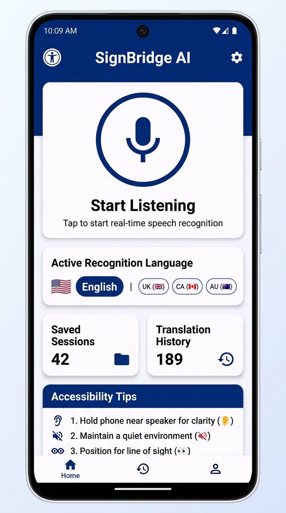
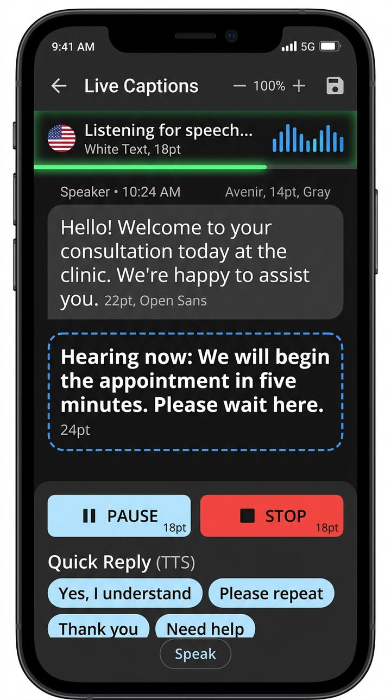
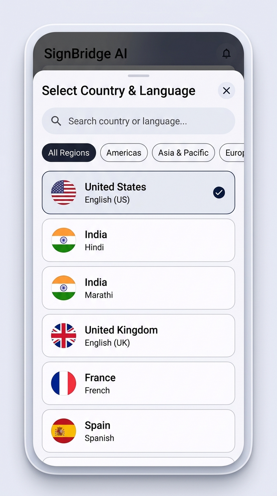
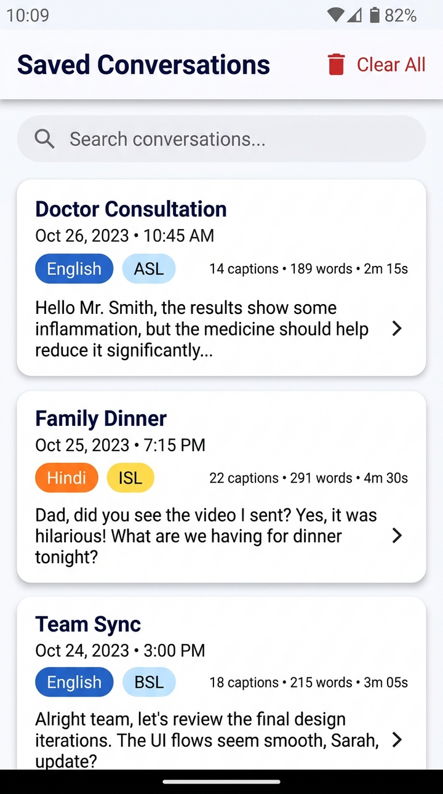

# SignBridge AI – Real-Time Speech-to-Text Live Captions for Android

[](https://www.android.com)
[](https://www.java.com)
[](https://m3.material.io)
[](LICENSE)

**SignBridge AI** (`com.vaibhav.signbridgeai`) is a native Android accessibility application designed specifically for deaf and hard-of-hearing individuals. Built natively using **Java and XML layouts in Android Studio**, it transforms spoken face-to-face conversations into readable, high-contrast captions on the user's mobile screen in real time.

---

## 📋 Table of Contents
1. [Project Overview](#-project-overview)
2. [Key Features](#-key-features)
3. [Technology Stack](#-technology-stack)
4. [Screens & Architecture](#-screens--architecture)
5. [Screenshots](#-screenshots)
6. [Setup & Build Instructions](#-setup--build-instructions)
7. [Running on a Physical Phone](#-running-on-a-physical-phone)
8. [Speech Recognition Limitations & Technical Realities](#-speech-recognition-limitations--technical-realities)
9. [Privacy & Security](#-privacy--security)
10. [Testing](#-testing)

---

## 🎯 Project Overview

For deaf and hard-of-hearing people, everyday interactions—such as doctor consultations, store visits, family discussions, and lectures—can be challenging without an interpreter. **SignBridge AI** bridges this communication gap by converting nearby people's spoken words into instant, readable text.

### Core Design Principles:
- **Zero Surprises / Manual Listening Control**: The microphone **never** turns on automatically upon opening the app. Listening only begins when the user taps **Start Listening**.
- **High Readability**: High-contrast color palette (deep blue `#0D47A1` and clean white, with optional high-contrast yellow-on-black mode) and on-the-fly caption font-size controls (18sp to 38sp).
- **Two-Way Communication**: Provides quick Text-to-Speech (TTS) response buttons and typed replies so deaf users can easily answer back aloud through the device's speaker.
- **100% Local Privacy**: All saved conversation history resides entirely inside an on-device SQLite database. No mandatory cloud accounts or external user tracking.

---

## 🌟 Key Features

### 1. Real-Time Speech-to-Text (Live Captions)
- **Continuous Android SpeechRecognizer Integration**: Interfaces with Android's native speech recognition system.
- **Partial & Final Transcriptions**: Displays real-time tentative speech in a floating "Hearing now…" card while speech is ongoing, and appends the final sentences to the captions timeline.
- **Visual Sound Level Meter**: 5-bar responsive audio waveform animating with voice volume (`onRmsChanged`), providing deaf users immediate visual confirmation that audio/voice is being detected.
- **Multilingual Support**: Supports English (`en-US`, `en-IN`, `en-GB`), Hindi (`hi-IN`), Marathi (`mr-IN`), and 25+ international languages across Americas, Europe, Asia-Pacific, and the Middle East.
- **Tactile Haptic Feedback**: Gentle vibration cues notify users when listening starts, when speech is detected, and when paused.

### 2. Manual Listening Control & Loop Safeguards
- **Zero Auto-Listening**: The microphone **never** activates automatically when opening the app.
- **Prominent Start Button**: Users explicitly initiate listening sessions via the large hero button on the Home screen.
- **Pause, Resume & Stop**: Controls allow users to pause listening, resume seamlessly, or stop the session immediately.
- **Robust Anti-Loop Mechanism**: Handles normal silence timeouts, applies exponential backoff for transient glitches, and limits consecutive retries to safeguard battery and performance.
- **Lifecycle Cleanliness**: Guarantees all calls to `SpeechRecognizer` occur on the main Android thread, resetting the engine binder on busy states and destroying instances cleanly on session exit or activity destruction.

### 3. Accessible Live Captions Interface
- **Large High-Legibility Typography**: Conversation-style message bubbles with timestamps and speaker tags.
- **Dynamic Text Resizing**: Instant font size zoom controls (**+** / **-**) on the top bar (18sp, 24sp, 30sp, 38sp).
- **Auto-Scrolling**: Keeps the latest recognized sentence in view automatically.
- **Dual-Communication TTS (Text-to-Speech)**: Allows deaf users to type a response or tap quick phrase chips (*"Yes, I understand"*, *"No, thank you"*, *"Please repeat that slowly"*, *"I am deaf, thank you for speaking clearly"*) to speak aloud through the device speaker.
- **Session Actions**: Clear conversation with confirmation, or save the transcript directly to History.

### 4. Local Conversation History
- **100% Local SQLite Storage**: Zero server uploads, zero mandatory accounts or registrations.
- **Rich Session Details**: Stores duration, language badge, sentence count, word count, and full transcripts.
- **Search & Management**: Real-time search filter, single session deletion with confirmation dialog, and "Clear All" with confirmation safeguard.
- **Transcript Detail**: Read past conversations sentence by sentence, copy all text to clipboard, or share via the Android share sheet.

### 5. Accessibility & Display Settings
- **Display Themes**: Light Mode (Deep Blue `#0D47A1`), Dark Mode (Deep Navy `#0B1325`), High-Contrast Mode (Yellow on Black), and System Default.
- **Screen & Feedback Controls**: Toggles for gentle haptic vibration, Keep Screen Awake, and Auto-Save.
- **Microphone Status Diagnostic**: Built-in permission status indicator with a direct link to Android App Settings.

---

## 🛠 Technology Stack

- **Operating System**: Android (API level 24 through 36)
- **Language**: 100% Java (JDK 11 / 17 compatible)
- **Architecture**: Native Android Activities, Adapters, Model, Repository pattern
- **UI Framework**: Native XML Layouts with Material Design 3 Components (`MaterialCardView`, `MaterialButton`, `MaterialToolbar`, `MaterialSwitch`, `ChipGroup`, `BottomSheetDialog`)
- **Speech Engine**: Android Native `android.speech.SpeechRecognizer`
- **Speech Output**: Android Native `android.speech.tts.TextToSpeech`
- **Database**: Local SQLite Database (`android.database.sqlite.SQLiteOpenHelper`)
- **Settings**: Android `SharedPreferences`
- **Build System**: Gradle 9.3+ with Gradle Wrapper (`gradlew`, `gradlew.bat`)

---

## 📱 Screens & Architecture

```
com.vaibhav.signbridgeai
 ├── SignBridgeApp.java               # Custom Application class (applies theme globally)
 ├── SplashActivity.java              # Splash screen with logo branding
 ├── MainActivity.java                # Home screen with Start Listening, Stats, and Language selector
 ├── LiveCaptionsActivity.java        # Core live captioning interface with sound bars and TTS
 ├── HistoryActivity.java             # Saved conversation sessions with search and delete
 ├── TranscriptDetailActivity.java    # Full transcript inspector, clipboard copy & share
 ├── SettingsActivity.java            # Accessibility, font size, theme, and haptic controls
 ├── AboutActivity.java               # Mission statement, deaf accessibility guides, and privacy
 ├── adapter
 │   ├── CaptionAdapter.java          # Dynamic font-scaling caption items adapter
 │   ├── SessionAdapter.java          # Saved sessions list adapter
 │   └── LanguageAdapter.java         # Country and language picker adapter
 ├── db
 │   ├── DatabaseHelper.java          # SQLite schema creation & table migrations
 │   └── SessionRepository.java       # Thread-safe CRUD data access methods
 ├── dialog
 │   └── LanguageSelectBottomSheet.java # Searchable country & language bottom sheet
 ├── model
 │   ├── CaptionItem.java             # Individual utterance model
 │   ├── ConversationSession.java     # Session metadata and duration model
 │   └── LanguageItem.java            # Country, language, flag, and region model
 ├── speech
 │   └── SpeechManager.java           # Hardened continuous speech recognizer controller
 ├── tts
 │   └── TtsManager.java              # Text-to-speech speaker output manager
 └── util
     ├── AppPreferences.java          # SharedPreferences persistence
     ├── HapticHelper.java            # Tactile vibration feedback
     └── LanguageHelper.java          # Registry of 30+ countries and languages
```

---

## 📸 App Screenshots

| 1. Home Screen | 2. Live Captions Screen | 3. Country & Language Selection | 4. Saved Conversation History |
|:---:|:---:|:---:|:---:|
|  |  |  |  |
| **Start Listening Hero**<br/>One-tap manual trigger, active language pill & stats | **Real-Time Live Captions**<br/>Volume meter, tentative speech & Quick Reply TTS | **Multi-Country Picker**<br/>30+ countries, flag badges & region filters | **Saved History & Search**<br/>Searchable SQLite transcripts & delete safeguards |

---

## 🚀 Setup & Build Instructions

### Prerequisites
- Android Studio Ladybug, Koala, Hedgehog, or newer.
- Java Development Kit (JDK) 11 or 17.
- Android SDK with platform tools installed (API 24+).

### Building with the Gradle Wrapper
You can build the project from the command line using the included Gradle wrapper:

```bash
# On Linux / macOS
./gradlew assembleDebug

# On Windows
gradlew.bat assembleDebug
```

The compiled APK will be generated at:
```
app/build/outputs/apk/debug/app-debug.apk
```

---

## 📲 Running on a Physical Phone

Speech recognition relies on the device microphone and speech engine. Testing on a physical Android phone is recommended:

1. On your Android phone, navigate to **Settings > About Phone** and tap **Build Number** 7 times to enable **Developer Options**.
2. Open **Developer Options** and enable **USB Debugging**.
3. Connect your Android phone to your computer via USB.
4. In Android Studio, select your physical device from the deployment dropdown.
5. Click **Run** (`Shift + F10`).
6. Grant the **Microphone Permission** when prompted upon pressing **Start Listening**.

---

## ⚠️ Speech Recognition Limitations & Technical Realities

To maintain complete transparency and avoid misleading claims:

1. **External Recognition Provider**:
   - `Android SpeechRecognizer` delegates audio transcription to the device's system speech engine (typically **Google Speech Services** on most certified Android devices).
   - **On-device speech processing is NOT guaranteed.** Depending on the Android version, manufacturer OEM, and device hardware, speech recognition may process audio via network requests to Google servers rather than fully offline.
2. **Language Availability**:
   - Recognition in **English**, **Hindi**, **Marathi**, or any other language is only functional if the underlying speech engine on the device supports that language.
   - If a language is missing or offline recognition is desired, users should verify in their device settings: **Settings > System > Languages > Voice input > Offline speech recognition** and download the desired language pack (e.g., English, Hindi, Marathi).
3. **Audio Quality**:
   - Background noise, distance from the speaker, and overlapping voices can impact recognition accuracy. For best results, place the phone within 1–2 meters of the person speaking.

---

## 🔒 Privacy & Security

- **No Secret Recording**: The microphone is never activated in the background or upon app launch.
- **No Cloud Uploads**: Conversations and transcripts are saved strictly to the on-device SQLite database (`signbridge_conversations.db`).
- **No Account Required**: The application does not require any login, username, phone number, or email.
- **Zero Hardcoded Secrets**: Does not package or embed private API keys or signing credentials.
- **User Control**: Users can clear current live captions or delete saved sessions at any time with a confirmation prompt.

---

## 🧪 Testing

To run the unit test suite:
```bash
# On Linux / macOS
./gradlew :app:testDebugUnitTest

# On Windows
gradlew.bat :app:testDebugUnitTest
```
All unit tests validate data models, duration calculations, country/language registries, and database helper operations.
